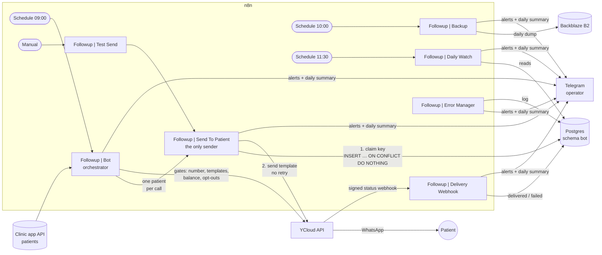

# n8n-followup-bot

A WhatsApp follow-up bot for a nutrition clinic, built on **n8n**, the **YCloud** WhatsApp
Business API and **Postgres (Supabase)**. Every morning it finds the patients who reached a
milestone of their nutrition plan (day 20 and day 42) and sends each of them one approved
WhatsApp template. It has run unattended in production since September 2026.

> **Portfolio copy.** This is a sanitized export of a real client project. Phone numbers,
> credential ids, chat ids, URLs and the client's name were replaced by placeholders. The
> workflows, the validator and the design documents are the real ones, translated to English.

## The problem

Sending a scheduled WhatsApp message sounds trivial. The hard part is sending it **exactly
once**.

The first version of this bot (a different stack) sent a patient a **duplicate message**. The
number got reported, WhatsApp **banned it**, and the business lost the number. So this rebuild
is designed around one rule:

> **Never send a patient a duplicate message.** When in doubt about whether a message went
> out, do not resend: alert a human and let them decide.

Delivery is sacrificed before risking a duplicate. Everything below follows from that rule.

## Architecture



| Workflow | Role | Can it send a WhatsApp? |
|---|---|---|
| `Followup \| Bot` | Daily orchestrator: health gates, candidate selection, template alternation, daily summary | Indirectly — calls the sender once per patient |
| `Followup \| Send To Patient` | **The only workflow that sends.** Claims the dedup key, sends, records the result | Yes, only when called |
| `Followup \| Test Send` | Manual launcher that sends to a test number through the real path | Yes, only when run by hand |
| `Followup \| Delivery Webhook` | Verifies the YCloud HMAC signature and writes `delivered` / `failed` | No |
| `Followup \| Error Manager` | Error Trigger → stores the error in `bot.errors` → Telegram alert | No |
| `Followup \| Backup` | Dumps `bot.sends` to Backblaze B2 every day | No |
| `Followup \| Daily Watch` | Morning report: stuck cases, failures, unsent alerts, backup freshness. Sent even when everything is zero | No |
| `Followup \| SQL Console` · `YCloud Console` · `Backup Console` | Manual read-only consoles | No |

### How a message is sent exactly once

1. **The key is the lock.** `unique_key = {patient_id}_{plan_start_date}_{milestone}`. It uses
   the plan *start* date, not today's date, so it is the same on every day of the 3-day sending
   window.
2. **Claim before send, atomically.** `INSERT … ON CONFLICT (unique_key) DO NOTHING RETURNING`.
   No row returned means someone already owns the key, and nothing is sent. A failed write means no
   send either.
3. **No automatic retry on the send call.** The provider's send endpoint takes no idempotency
   key, so a retry after a timeout could be a second message. A missing response leaves the
   row `ambiguous`.
4. **Only the delivery webhook writes `delivered`.** A `2xx` from the API means "accepted",
   not "delivered". Ambiguous rows are resolved by waiting for the signed webhook (12 h TTL),
   never by resending.
5. **Keys are never deleted.** The database role used by n8n has no `DELETE` on `bot.sends`.

## Repository layout

```
workflows/          n8n exports of the 10 workflows (all exported with active: false)
validator/          offline/online static checker for the invariants n8n cannot enforce
docs/behavior-spec.md   the behavior spec: 17 invariants and the closed design decisions, each with its "why"
db/schema.sql       Postgres schema (schema bot, role n8n_bot, config seed)
db/operations.sql   day-to-day operational queries
```

## How to run it

You need an n8n instance (self-hosted, 1.x), a Postgres database (Supabase works), a YCloud
account with an approved WhatsApp number and templates, a Telegram bot, and optionally a
Backblaze B2 bucket.

1. **Database.** Edit the role password in [`db/schema.sql`](db/schema.sql) and run it as the
   database owner.
2. **Credentials in n8n.** Create the credentials the workflows reference: Postgres (`n8n_bot`
   role), YCloud API key (header auth), Telegram bot, B2 (S3-compatible), and the clinic app's
   login. The exports reference them by placeholder ids (`CREDENTIAL_ID_n`), so re-link each
   node after import.
3. **Import the workflows** from [`workflows/`](workflows/). Import `Error Manager` and
   `Send To Patient` first, then update the workflow ids in the `errorWorkflow` setting and in
   the Execute Workflow nodes if your instance assigned new ones.
4. **Replace the placeholders:** `YOUR_TELEGRAM_CHAT_ID`, `+15555550199` (the business sender
   number), `+15555550100` (your test number), `api.clinic.example` (the patient source),
   `your-backup-bucket`, and the webhook path suffix.
5. **Register the delivery webhook in YCloud** and **enable it** — new endpoints are created
   `disabled`, and the symptom of forgetting is silence, not an error. Store its signing secret
   in `bot.config` (`ycloud_webhook_secret`).
6. **Validate** (see below), run `Test Send` once, then activate the schedules.

**To stop the bot, don't turn the schedule off.** Set the brake flag instead:

```sql
update bot.config set value = 'true' where name = 'account_restricted';
```

The bot keeps running, aborts before writing any key, and sends a "run aborted" alert every
day with the reason. Switching the schedule off would make the system silent, and silence cannot be told
apart from a crashed n8n.

## How it is tested

The invariants that matter most are structural, and n8n raises **no error** when someone breaks
them: a `retryOnFail: true` on the send node, a send wired before the key claim, a disabled
gate, a `DELETE` in a query, a Telegram node without `parse_mode`. The
[validator](validator/) checks them statically.

```bash
# Check the exported workflows in this repo (offline, no credentials needed)
node validator/validate.mjs --from workflows

# Mutation tests: break each invariant on purpose and assert the validator catches it
node validator/test.mjs

# Check a live instance (read-only GET)
node validator/validate.mjs
```

Live mode reads the n8n API key from the macOS Keychain (item `n8n-api-key`) and the instance URL
from `API_URL` in [`validator/validate.mjs`](validator/validate.mjs); see the
[validator README](validator/README.md).

The last line always starts with `RESULT`. Exit code `0` = pass, `1` = violations, `2` =
**could not verify**, which is deliberately not the same as passing. `test.mjs` mutates a clean
fixture 11 ways (one per rule), checks that each mutation is caught, and checks that 2 known
false positives are not flagged.

Real sends are verified through `Test Send`, which goes through the production sender with a
`TEST_`-prefixed, timestamped key so it can never collide with a patient's key.

## Design decisions

The full reasoning is in [`docs/behavior-spec.md`](docs/behavior-spec.md). The ones that shaped
the system most:

- **Fail closed, loudly.** Health gates (number status and quality, messaging limit, template
  approval, balance, manual brake) run **before the first key is written**. If one fails, the
  run aborts without writing anything and alerts.
- **Abort, don't truncate.** If a run finds more than 50 candidates, it sends nothing and alerts.
  A cap that sends the first N hides a date bug that made everyone eligible; an abort exposes it.
- **An empty read is an error, not "nobody to contact".** Zero patients from the API, or fewer
  than it declares, aborts the run. So does a `bot.sends` row count below the stored watermark
  (`sends_max_seen`). A permissions or schema change looks exactly like "nobody was ever
  contacted".
- **Silence is failure.** Every day produces at least one message, even "0 sent, all good". The
  daily watch runs on its own schedule, not at the end of the send chain, so a day with no
  candidates doesn't switch off the only alarm.
- **Dedup state lives outside n8n**, in a managed Postgres with daily off-site backups. The graph
  can be rebuilt from the spec in an afternoon; the keys cannot. Restoring a backup leaves the
  bot disabled until sends are reconciled against the provider's log.
- **The surname is not part of the key.** Names get edited ("Perez" → "Pérez"); a key that
  changes with them would resend.
- **Explicit item lineage, never positional indexes**, so a filter added upstream can't send
  patient A's message to patient B's phone.
- **Alerts can't fail because of their own text.** Error messages from the provider are escaped
  before going into Telegram HTML.
- **Template alternation per patient.** The day-20 milestone alternates between a Utility and a
  Marketing template across a patient's plans, and marketing opt-outs are checked *before*
  picking the template.

## Stack

n8n · YCloud (WhatsApp Business API, coexistence mode) · Postgres on Supabase · Backblaze B2 ·
Telegram · Node.js (validator, no dependencies)

## License

[MIT](LICENSE)
